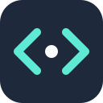

<p align="center"></p>

<h1 align="center">datacamp-agent (<code>dcai</code>)</h1>

<p align="center">
  A cache-first, token-frugal CLI that works through DataCamp exercises in your own logged-in browser — deterministic Python for everything it can, an LLM only when it must.
</p>

<p align="center">
  <a href="https://github.com/SyedMuhammadFaheem/datacamp-agent/actions/workflows/ci.yml"></a>
  <a href="LICENSE"></a>
  
  
</p>

> **Unofficial.** This project is not affiliated with, endorsed by, or sponsored by DataCamp. Read
> [Responsible use](#responsible-use-and-limitations) before running it.

## The problem

An LLM agent that clicks through a learning platform and reasons over full pages burns a lot of tokens and
re-derives things it already knows every session. It is also opaque: hard to reproduce, audit, or resume.

## The approach

`dcai` moves everything deterministic out of the LLM:

- **Navigation, extraction, submission and validation are plain Python**, driving the real DataCamp UI in a Chrome
  you already launched and logged in to, over the raw Chrome DevTools Protocol (no Playwright/Selenium).
- **The LLM only ever sees a tiny normalised struct** — `instructions`, `starter_code`, `context`, `hints`,
  `error_output`. Never raw HTML, never screenshots.
- **Cache first.** A solution that was already accepted for identical instructions is reused with **zero LLM calls**.
- **Capped repair.** A rejected submission gets one repair attempt (existing code + DataCamp's error message only).
- **UI-verified.** An exercise counts as solved only when DataCamp's UI confirms it — not by assumption.
- **Everything is recorded in SQLite** — solutions, attempts, and per-call token usage — so `dcai stats` can report
  cache-hit rate and cost from a plain query.

## Features

- Solves **Python coding**, **multiple-choice** and **video/intro** pages end to end (live-verified, see
  [status](#status)).
- Two interchangeable LLM providers: `claude-code` (your `claude` CLI login; default) and `claude-api`
  (Anthropic API key).
- `status`, `stats`, `notes` and `migrate` are pure database reads/writes — no browser, no LLM, no tokens.
- Halts on CAPTCHA / paywall signals instead of guessing (best-effort detection; see limitations).
- Small: one runtime dependency (`websocket-client`), hand-written SQL, no ORM.

## How it works

```
DataCamp UI ─► CDPAdapter (raw Chrome DevTools Protocol)
            ─► normalize/   DOM → Exercise{instructions, code, context, hints, error}
            ─► solver/pipeline.py
                  cache hit?      → submit directly            (0 LLM calls)
                  deterministic?  → rule-based solve           (tier is a stub today)
                  otherwise       → tiny LLM prompt, code-only reply, syntax-checked before submit
            ─► submit ─► validate from UI feedback ─► one capped repair on failure
            ─► SQLite: courses, chapters, exercises, solutions, attempts, state, course_memory, token_usage
```

- `adapters/` — `BrowserAdapter` interface; `cdp.py` is the only implementation. All DOM selectors and injected JS
  live in `adapters/selectors.py`, so markup drift is a one-file fix.
- `normalize/` — turns live DOM state into the `Exercise` struct.
- `solver/` — cache → deterministic → LLM → repair, each step recorded in `token_usage` (zeros for cache hits).
- `llm/` — `LLMProvider` interface with `claude_code.py` and `claude.py`; adding a provider is one small class.
- `db/` — parameterised SQL in `repo.py`, schema in `db/schema.sql`.

## Requirements

- Python 3.11+
- Google Chrome or Chromium, started with remote debugging (below). `dcai` attaches to **your** already-running,
  already-authenticated browser; it never launches its own or touches your credentials.
- An LLM backend, only for exercises without a cached solution (not needed for `status`/`stats`/`notes`/`migrate`).

## Quick start

```bash
git clone https://github.com/SyedMuhammadFaheem/datacamp-agent.git
cd datacamp-agent
python3 -m venv .venv && source .venv/bin/activate
pip install -e ".[dev,claude]"     # drop ,claude if you'll use the claude-code provider
```

### 1. Launch a dedicated Chrome with remote debugging

```bash
# macOS (launch the binary directly; `open -a` ignores flags if Chrome is already running)
"/Applications/Google Chrome.app/Contents/MacOS/Google Chrome" \
  --remote-debugging-port=9222 --remote-allow-origins="*" --user-data-dir="$HOME/.dcai-chrome" &

# Linux
google-chrome --remote-debugging-port=9222 --remote-allow-origins="*" --user-data-dir="$HOME/.dcai-chrome"
```

```powershell
# Windows (PowerShell)
& "C:\Program Files\Google\Chrome\Application\chrome.exe" --remote-debugging-port=9222 --remote-allow-origins="*" --user-data-dir="$env:USERPROFILE\.dcai-chrome"
```

- `--remote-allow-origins="*"` is needed on current Chrome, otherwise the WebSocket handshake gets a 403.
- The separate `--user-data-dir` creates an **isolated profile**. **Log into DataCamp in that window** (once — the
  profile persists). Your everyday Chrome has no debug port and is invisible to `dcai`.
- **Security:** anything that can reach that port can control that browser. Use the profile only for this tool, and
  keep the port on localhost (see [SECURITY.md](SECURITY.md)).

### 2. Pick an LLM provider (only for uncached exercises)

| Provider | Auth | Cost per solve call | Notes |
|---|---|---|---|
| `claude-code` (**default**) | Your existing `claude` CLI login — no API key | Higher: each headless `claude -p` call carries ~10–17.5k tokens of fixed Claude Code overhead that did not hit the prompt cache in the maintainer's testing. Counts against your subscription. | Needs the `claude` CLI installed and logged in. |
| `claude-api` | `ANTHROPIC_API_KEY` (metered billing) | Much lower: a few hundred tokens per call — just the normalised struct. | Needs `pip install -e ".[claude]"`. |

`claude-code` is the default because it needs no separate API bill; that is a deliberate trade-off against
per-call token efficiency. If token count matters more to you, use the API provider:

```bash
export ANTHROPIC_API_KEY=...          # never commit this
dcai --llm-provider claude-api start "<url>"
# or: export DCAI_LLM_PROVIDER=claude-api
```

### 3. Run it

```bash
# Solve the exercise currently open at this URL (one exercise per call for now)
dcai start "https://campus.datacamp.com/courses/<course-slug>/<chapter-slug>?ex=1"

dcai resume                     # re-attach to the last checkpointed URL
dcai status                     # progress — pure DB read
dcai stats                      # token usage, cost, cache-hit rate — pure DB read
dcai notes <course-slug> --out notes.md   # render accumulated concept notes
dcai migrate --legacy-dir courses         # import an older markdown/JSON progress folder (idempotent)
```

Global flags (before the subcommand): `--cdp-port` (default `9222`, or `DCAI_CDP_PORT`), `--db-path` (default
`$XDG_DATA_HOME/dcai/dcai.db`, i.e. `~/.local/share/dcai/dcai.db`), `--llm-provider` (default `claude-code`, or
`DCAI_LLM_PROVIDER`), `-v/--verbose`.

## Configuration

| Setting | Flag | Environment variable | Default |
|---|---|---|---|
| Chrome debug port | `--cdp-port` | `DCAI_CDP_PORT` | `9222` |
| Database file | `--db-path` | `XDG_DATA_HOME` (directory) | `~/.local/share/dcai/dcai.db` |
| LLM provider | `--llm-provider` | `DCAI_LLM_PROVIDER` | `claude-code` |
| Anthropic key (`claude-api`) | — | `ANTHROPIC_API_KEY` | — |

Exit codes for `start`/`resume`: `0` accepted, `1` not accepted, `2` blocked (CAPTCHA/paywall), `3` Chrome not
reachable.

## When something goes wrong

- **No Chrome reachable** — exits with a message telling you to launch Chrome with `--remote-debugging-port`.
- **CAPTCHA / paywall signal** — the run stops, the course is marked `blocked`, nothing is bypassed. Resolve it in
  the browser yourself, then re-run.
- **Submission rejected** — one automatic repair attempt; if that also fails the exercise is marked `failed` and
  shows up in `dcai status` for you to finish by hand.

## Development

```bash
pip install -e ".[dev,claude]"
ruff check src tests
pytest            # 19 offline tests: no Chrome, network or API key
```

| Test file | Covers |
|---|---|
| `tests/test_solver_pipeline.py` | Core guarantees: cache hit = 0 LLM calls; fresh exercise = 1; failed submission = exactly one capped repair; no cross-exercise cache leaks |
| `tests/test_db_schema.py` | Schema constraints and lookups |
| `tests/test_normalize.py` | Deterministic, whitespace-insensitive `instructions_hash` |
| `tests/test_migration.py` | Legacy import is correct and idempotent |
| `tests/test_selectors.py` | Editor content is embedded into injected JS as a safe literal |

`tests/fakes.py` provides `FakeBrowserAdapter` and `FakeLLMProvider`. The CDP adapter itself is only verified
manually against the live site. See [CONTRIBUTING.md](CONTRIBUTING.md) and
[docs/project-state.md](docs/project-state.md) (verification notes and phase plan).

## Status

**Alpha.** Live-verified (2026-09-29, one Python course): coding, multiple-choice and video/intro pages, including
submission and UI-confirmed acceptance. Not built or not verified live:

- `start`/`resume` handle **one exercise per invocation**; automatic traversal of chapters/exercises is not built,
  and exercise numbering in the database is still hard-coded to 1 (top-priority fix, see project notes).
- SQL exercises are classified but not live-verified; R, drag-and-drop, projects and assignments are unsupported.
- The deterministic (rule-based) solver tier is a stub; only the cache short-circuits the LLM today.
- No database migration mechanism yet — schema changes need a fresh DB file.
- DataCamp's markup can change at any time and break selectors.

## Responsible use and limitations

- **Your own account only.** `dcai` operates only in a browser session you have logged into yourself. It never
  stores or transmits credentials, never calls undocumented APIs, and does not bypass CAPTCHAs, MFA, paywalls,
  rate limits or other access controls — it stops instead.
- **Check the rules that apply to you.** DataCamp's Terms of Use may restrict automated access, and your
  employer, school or instructor may prohibit automated completion of assignments. Automating exercises can defeat
  their learning purpose and is inappropriate for graded work or for earning credentials you have not earned. You
  are responsible for how you use this software.
- **Content.** The local database stores exercise text and generated solutions. That is DataCamp's content: keep
  it private and don't redistribute it.
- **Data sent to an LLM.** Exercise instructions, starter code and error text go to the LLM provider you select.
- **No guarantees.** LLM answers can be wrong; a wrong attempt is recorded and reported, never hidden.

## Roadmap

1. Real chapter/exercise position tracking (fixes the hard-coded exercise number), then multi-exercise traversal
   for `resume`.
2. Deterministic solver tier (MCQ answer key, code patterns) driven by observed repeats.
3. SQL/R exercise types, then projects/assignments.
4. Schema migrations for the SQLite database.
5. Additional LLM providers.

## Contributing

Issues and pull requests are welcome — please read [CONTRIBUTING.md](CONTRIBUTING.md) (notably the rules about
access controls and token discipline) and the [Code of Conduct](CODE_OF_CONDUCT.md). Report vulnerabilities via
[SECURITY.md](SECURITY.md).

## License

[MIT](LICENSE). "DataCamp" is a trademark of its respective owner and is used here only to describe what the tool
works with.
